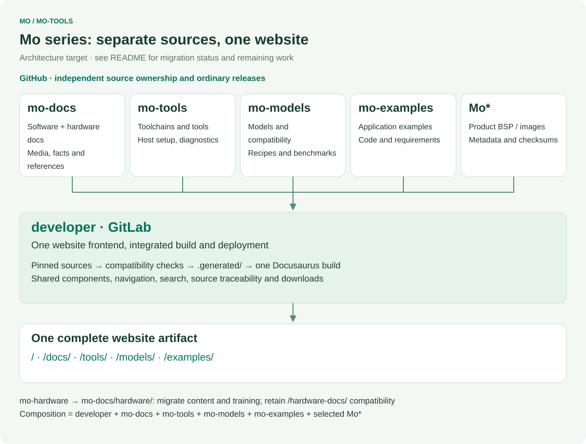
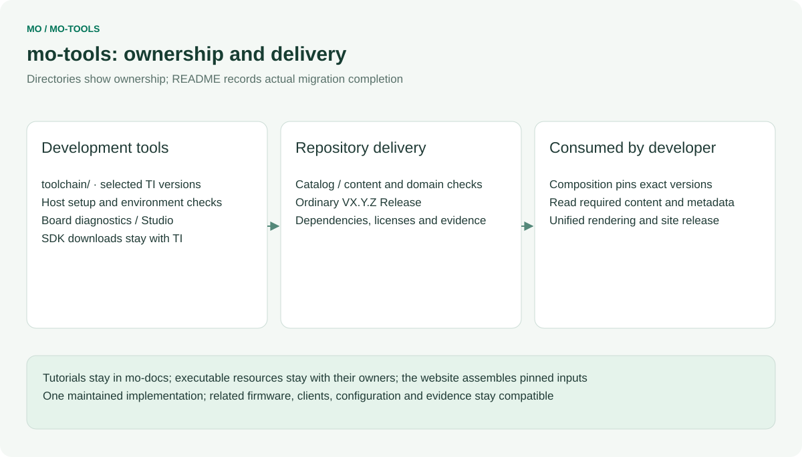
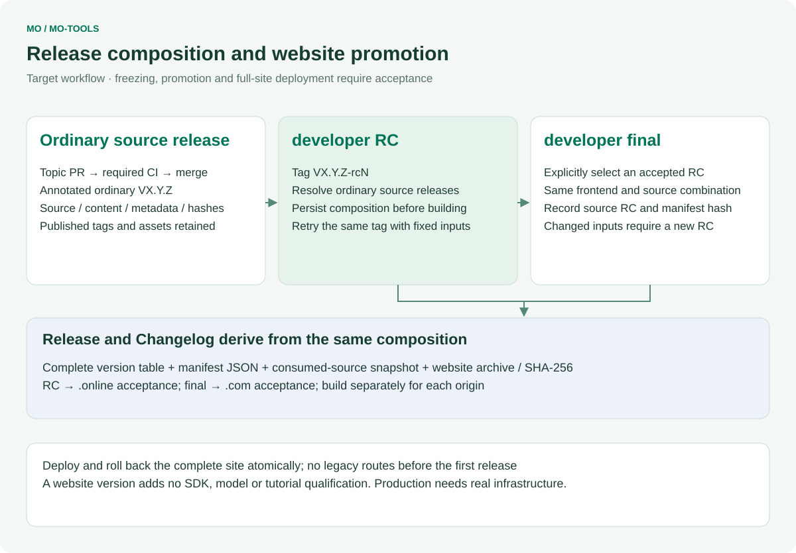

# mo-tools

English | [简体中文](README.zh-CN.md)

Mo Studio and toolchain usage examples for InHand Mo series single-board computers.

This repository will hold Mo Studio, the desktop companion application for Mo boards, and worked examples that show how to use the Mo toolchain (compilers, debuggers, flashing and board bring-up utilities) from a development host.

Related repositories:

- [Mo62A](https://github.com/inhandnet/Mo62A) — board support package, OS image build and device-side runtime for the Mo 62A board.
- [mo-docs](https://github.com/inhandnet/mo-docs) — product documentation for the Mo series.

## Mo series repository architecture

[](architecture/repository-map.en.svg)

<table width="100%">
  <thead>
    <tr>
      <th width="171" align="left">Repository</th>
      <th width="398" align="left">Maintained source</th>
      <th width="379" align="left">Delivery responsibility</th>
    </tr>
  </thead>
  <tbody>
    <tr>
      <td align="left"><strong>developer</strong> · GitLab</td>
      <td align="left">Website components, routes, search, integration and contracts</td>
      <td align="left">The complete website, release composition and deployment</td>
    </tr>
    <tr>
      <td align="left"><a href="https://github.com/inhandnet/mo-docs">mo-docs</a></td>
      <td align="left">Software/hardware tutorials, specifications, media, design files and training</td>
      <td align="left">Versioned content and reference assets</td>
    </tr>
    <tr>
      <td align="left"><a href="https://github.com/inhandnet/mo-tools">mo-tools</a></td>
      <td align="left">Toolchain/SDK selection, environment setup, reusable tools and Studio</td>
      <td align="left">Tool metadata and source packages</td>
    </tr>
    <tr>
      <td align="left"><a href="https://github.com/inhandnet/mo-models">mo-models</a></td>
      <td align="left">Model catalog, compilation resources, compatibility and raw benchmarks</td>
      <td align="left">Model references, evidence and artifact status</td>
    </tr>
    <tr>
      <td align="left"><a href="https://github.com/inhandnet/mo-examples">mo-examples</a></td>
      <td align="left">Complete examples with related firmware, clients and configuration</td>
      <td align="left">Example sources and their requirements</td>
    </tr>
    <tr>
      <td align="left"><strong>Mo*</strong> · product repositories</td>
      <td align="left">Each product&#x27;s BSP, drivers, root filesystem, image build and flashing</td>
      <td align="left">Product images and checksummed release metadata</td>
    </tr>
  </tbody>
</table>

`Mo*` covers independently maintained product repositories such as [Mo62A](https://github.com/inhandnet/Mo62A), Mo68A, Mo69A, Mo67A, Mo3588 and Mo3568. The framework does not fix their number. Hardware content and maintainer training move from mo-hardware into mo-docs; mo-hardware remains a historical migration source and is not a separate member of the target website composition.

Each source repository publishes ordinary versions. Developer alone has website RC/final channels. The target composition binds **developer + mo-docs + mo-tools + mo-models + mo-examples + selected Mo\*** to exact commits and consumed-asset hashes. A new source release does not change an already frozen website combination. Tutorial applicability, PCB revisions, image versions and actual validation remain distinct.

## Repository ownership

[](architecture/ownership.en.svg)

## Status

The directory layout, contribution rules and the CI and release pipelines are in place. `toolchain/` holds the pinned TI edgeai-tidl-tools baseline (`versions.json`) and the x86 host setup scripts; `board-test/` holds the Mo62A desktop board test tool migrated from the Mo62A repository. `studio/` is still a placeholder. Published archives are listed under GitHub Releases; their existence does not establish hardware or production qualification.

## Repository layout

<table width="100%">
  <thead>
    <tr>
      <th width="284" align="left">Path</th>
      <th width="664" align="left">Purpose</th>
    </tr>
  </thead>
  <tbody>
    <tr>
      <td align="left"><code>toolchain/</code></td>
      <td align="left">Pinned TI toolchain versions, official download links and host setup scripts.</td>
    </tr>
    <tr>
      <td align="left"><code>board-test/</code></td>
      <td align="left">Mo62A board test tool (PySide6 GUI over SSH, HTML reports).</td>
    </tr>
    <tr>
      <td align="left"><code>studio/</code></td>
      <td align="left">Mo Studio (placeholder).</td>
    </tr>
    <tr>
      <td align="left"><code>scripts/</code></td>
      <td align="left">Repository maintenance scripts (commit message check, changelog generation).</td>
    </tr>
    <tr>
      <td align="left"><code>.githooks/</code></td>
      <td align="left">Git hooks that run the commit message check locally.</td>
    </tr>
    <tr>
      <td align="left"><code>.github/</code></td>
      <td align="left">Issue forms, pull request template and GitHub Actions workflows.</td>
    </tr>
    <tr>
      <td align="left"><code>release-notes/</code></td>
      <td align="left">Changelog baseline used by the release workflow.</td>
    </tr>
  </tbody>
</table>

## Contributing

Contributions are welcome through pull requests to `master`. Read [CONTRIBUTING.md](CONTRIBUTING.md) for the commit message convention, the pull request process and how to enable the local Git hooks:

```bash
git config core.hooksPath .githooks
```

Every pull request must pass the `commit-message` and `ci` checks before it can be merged. Use GitHub issues for bugs, reproducible problems and feature requests in this repository.

## Releases and tags

[](architecture/release-flow.en.svg)

New releases use annotated ordinary `V<major>.<minor>.<patch>` tags on checked `master` commits. Only developer publishes website release candidates. The release workflow validates catalogs, packages source with SPDX SBOM, records the source commit and catalog hashes in `release.json`, writes SHA-256 checksums, then publishes a complete GitHub Release. Historical RCs remain unchanged. Changelog headings are bilingual; entries retain their English commit summaries.

```bash
git switch master
git pull --ff-only
git tag -a V1.0.0 -m "V1.0.0"
git push origin V1.0.0
```

## Security

Do not report security vulnerabilities in public issues. Follow [SECURITY.md](SECURITY.md).

## License

This repository is licensed under the terms in [LICENSE](LICENSE). Third-party content added later keeps its own license, stated next to the content.

## Unified website integration

`toolchain/versions.json` owns the selected TI toolchain versions and official download references. It includes the documented MCU+ SDK / Arm Clang / SysConfig combination; Linux/A53 cross-compilation remains explicitly unverified. SDK installers stay with TI. Developer reads a pinned source revision, validates the combined data, and renders the website; this repository has no documentation-site frontend or website deployment.

Run `node scripts/check-catalog.mjs` and `node --test tests/*.test.mjs` with Node 22. `validation/` is exported from a committed developer contract and checked by hash; do not edit it locally. For integrated preview, run developer's `npm run preview -- --source mo-tools=/path/to/mo-tools`.

Diagrams are generated centrally by developer/scripts/render-architecture.mjs. Regenerate all repository diagrams after changing the common architecture. Diagrams show ownership; the status section and catalog define currently available content and verification.

Regenerate these diagrams from developer with `node scripts/render-architecture.mjs --repo mo-tools --out /path/to/mo-tools/architecture`. Catalog and documentation changes remain in the topic PR; resource consolidation, release freezing and full-site rollout have separate acceptance. Open each diagram to read the original SVG.
