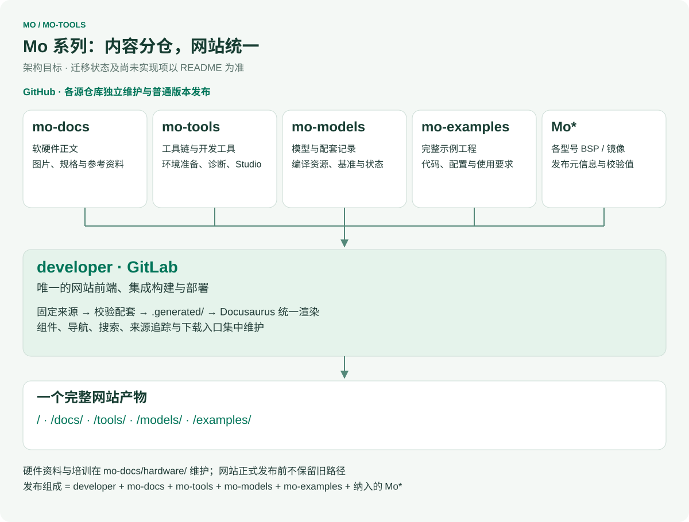
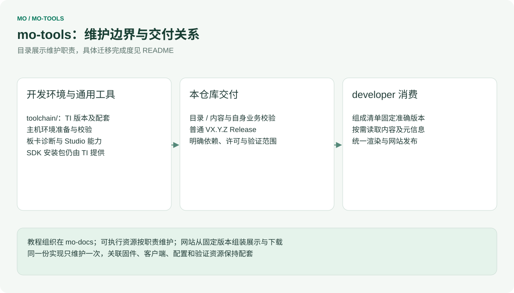
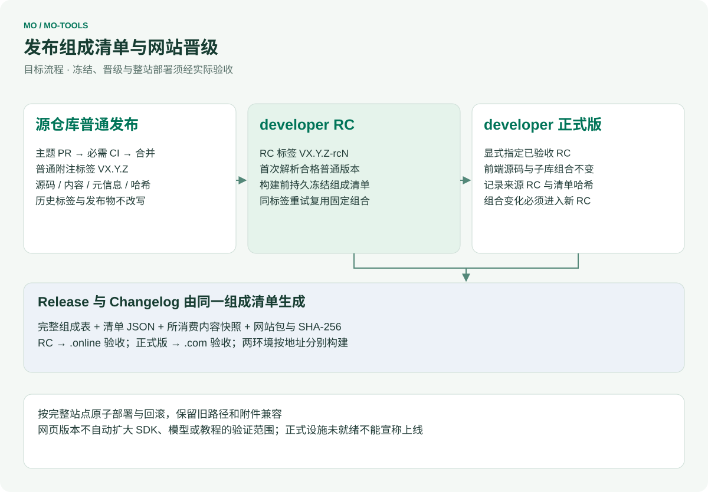

# mo-tools

[English](README.md) | 简体中文

InHand Mo 系列单板计算机的 Mo Studio 与工具链使用示例。

相关仓库：[Mo62A](https://github.com/inhandnet/Mo62A)（Mo 62A 板级支持与系统镜像）、[mo-docs](https://github.com/inhandnet/mo-docs)（产品文档）。

## Mo 系列仓库协同架构

<table width="100%">
  <thead>
    <tr>
      <th width="171" align="left">仓库</th>
      <th width="398" align="left">人工维护的源内容</th>
      <th width="379" align="left">交付职责</th>
    </tr>
  </thead>
  <tbody>
    <tr>
      <td align="left"><strong>developer</strong> · GitLab</td>
      <td align="left">网站组件、路由、搜索、接入层与内容接口</td>
      <td align="left">完整网站、发布组成清单与部署</td>
    </tr>
    <tr>
      <td align="left"><a href="https://github.com/inhandnet/mo-docs">mo-docs</a></td>
      <td align="left">软硬件教程、规格、媒体、设计资料与维护培训</td>
      <td align="left">版本化内容与参考附件</td>
    </tr>
    <tr>
      <td align="left"><a href="https://github.com/inhandnet/mo-tools">mo-tools</a></td>
      <td align="left">工具链/SDK 选择、环境准备、通用开发工具与 Studio</td>
      <td align="left">工具元信息和源码包</td>
    </tr>
    <tr>
      <td align="left"><a href="https://github.com/inhandnet/mo-models">mo-models</a></td>
      <td align="left">模型目录、编译资源、兼容关系与原始基准</td>
      <td align="left">模型引用、验证证据与托管状态</td>
    </tr>
    <tr>
      <td align="left"><a href="https://github.com/inhandnet/mo-examples">mo-examples</a></td>
      <td align="left">完整示例及配套固件、客户端和配置</td>
      <td align="left">示例源码及适用条件</td>
    </tr>
    <tr>
      <td align="left"><strong>Mo*</strong> · 各型号仓库</td>
      <td align="left">各自 BSP、驱动、根文件系统、镜像构建与烧录</td>
      <td align="left">系统镜像及带校验值的发布元信息</td>
    </tr>
  </tbody>
</table>

`Mo*` 表示各型号独立的产品仓库，例如 [Mo62A](https://github.com/inhandnet/Mo62A)、Mo68A、Mo69A、Mo67A、Mo3588、Mo3568，框架不固定数量。mo-hardware 的资料与维护培训迁入 mo-docs；mo-hardware 保留为历史迁移来源，不再单列为目标网站发布组成项。

各源仓库独立发布普通版本，只有 developer 区分网站 RC 与正式版。目标发布组成绑定 **developer + mo-docs + mo-tools + mo-models + mo-examples + 纳入的 Mo\***，记录准确提交与所消费附件哈希。上游新发版本不会改变已冻结的网站组合。教程适用范围、PCB 修订、镜像版本和实际验证结论分别记录。

## 本仓库维护边界

## 状态

目录结构、贡献规范以及 CI 与发布流水线已就绪。`toolchain/` 存放钉定的 TI edgeai-tidl-tools 版本（`versions.json`）与 x86 主机环境脚本；`board-test/` 存放从 Mo62A 仓库迁入的整机测试工具；`studio/` 仍为占位。历史发布包可在 GitHub Releases 查看；发布包的存在不代表新增硬件或生产认证。

## 目录结构

- `toolchain/` — 钉定的 TI 工具链版本、官方下载链接与主机环境脚本
- `board-test/` — Mo62A 整机测试工具（PySide6 图形界面，经 SSH 执行，输出 HTML 报告）
- `studio/` — Mo Studio（占位）
- `scripts/` — 仓库维护脚本（提交信息检查、变更记录生成）
- `.githooks/` — 本地提交信息检查钩子
- `.github/` — Issue 表单、PR 模板与 GitHub Actions 工作流

## 参与贡献

通过 PR 提交到 `master`。提交信息规范、PR 流程与本地钩子启用方法见 [CONTRIBUTING.md](CONTRIBUTING.md)（`git config core.hooksPath .githooks`）。PR 必须通过 `commit-message` 与 `ci` 两项检查后才能合并。使用本仓库的 GitHub Issues 提交可复现问题和功能建议。

## 发布与标签

新发布仅使用已通过检查的 master 提交上的普通附注标签 `VX.Y.Z`；只有 developer 发布网站 RC。工作流校验目录数据、生成源码包和 SPDX SBOM，在 release.json 中记录源码提交与目录哈希，计算 SHA-256，全部附件就绪后公开 Release。历史 RC 保留不变。Changelog 中英文标题固定，条目保留英文。

## 安全

请勿在公开 Issue 中报告安全漏洞，见 [SECURITY.md](SECURITY.md)。

## 许可证

见 [LICENSE](LICENSE)。

## 统一网站接入

toolchain/versions.json 维护 TI 工具链固定版本和官方入口，包含已有教程记录的 R5F SDK、Arm Clang、SysConfig 配套；Linux/A53 交叉编译组合仍标未验证。 developer 固定源码版本后统一校验和渲染，本仓库不部署文档网站。

Node 22 下运行 `node scripts/check-catalog.mjs` 和 `node --test tests/*.test.mjs`。validation/ 是 developer 已提交规则的固定副本，通过哈希核验，不手工编辑。集成预览在 developer 中运行 `npm run preview -- --source mo-tools=/path/to/mo-tools`。

框架图由 developer/scripts/render-architecture.mjs 统一生成，修改公共架构后同步生成各仓库图。图中为职责边界；当前可用目录和验证范围以状态段及目录清单为准。

生成本仓库图示：在 developer 中运行 `node scripts/render-architecture.mjs --repo mo-tools --out /path/to/mo-tools/architecture`。源仓库发布时校验目录和资源；developer 独立验收组合后的整站版本与部署。点击图示可查看原始 SVG。

## 教程工具归属

[diagnostics/peripherals](diagnostics/peripherals/README.md) 维护 GPIO、PWM、UART 通用诊断脚本；[toolchain/host-setup](toolchain/README.md) 维护模型编译的主机环境。教程与操作说明由 mo-docs 引用，developer 根据资源映射生成兼容下载地址。R5F 完整应用、固件与配套客户端归 mo-examples。
